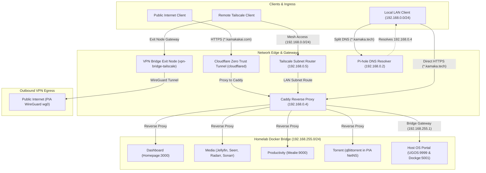

# Homelab Infrastructure and Configuration

This repository is adapted to manage a Synology DSM homelab. The current deployment, verified container names, ports, storage, Tailscale exposure, monitoring, and operation limits are documented in [the Synology deployment reference](.docs/synology.md).

The remaining architecture and provisioning material in this README is inherited reference-host guidance. Its UGREEN, Dockge, Caddy, PIA, `/volume2`, systemd, Restic, and public-ingress examples do not describe the active Synology deployment and must not be run on DSM without a reviewed adaptation.

---

## 1. Reference Architecture and Network Topology (not the active DSM deployment)

Traffic ingress and egress follow three segmented paths across physical LAN, Tailscale mesh, and Docker bridge networks:



* **Public Web Ingress (`*.kamakakai.com`)**: Ingress routes through an outbound Cloudflare Zero Trust tunnel (`cloudflared`) to Caddy without opening firewall ports behind CGNAT residential internet.
* **Private Homelab Ingress (`*.kamaka.tech`)**: Local LAN and Tailscale mesh management routes directly to Caddy (`192.168.0.4`) with automated Let's Encrypt DNS-01 wildcard TLS (`*.kamaka.tech`) and Pi-hole wildcard DNS resolution.
* **Client File Delivery (`download.kamaka.tech`)**: Authorized local and Tailscale clients download staged archives and files directly over HTTPS with an interactive directory index.
* **VPN Bridge Egress**: Remote mobile devices route outbound internet traffic through a dedicated Tailscale exit node (`vpn-bridge`) backed by WireGuard VPN egress, preserving client privacy on untrusted networks.

### 1.1 Network Subnets

| Network Name | Driver / Type | Subnet CIDR | Gateway | Operational Role |
| :--- | :--- | :--- | :--- | :--- |
| **Physical LAN** | Physical Ethernet | `192.168.0.0/24` | `192.168.0.1` | Local network for NAS host, gateway, and LAN devices |
| **Tailscale Mesh** | WireGuard Overlay | `100.64.0.0/10` | N/A | Encrypted peer-to-peer overlay network connecting remote devices |
| **`homelab`** | Docker `bridge` | `192.168.255.0/24` | `192.168.255.1` | Isolated container bridge linking Caddy with backend services |
| **`external_npm`** | Docker `macvlan` | `192.168.0.0/24` | `192.168.0.1` | Assigns dedicated LAN IPs to Caddy (`192.168.0.4`) and Tailscale (`192.168.0.5`) |

### 1.2 Static IP & DNS Assignments

| Hostname / Node | IP Address | Network Interface | Operational Role |
| :--- | :--- | :--- | :--- |
| **Gateway / Router** | `192.168.0.1` | Physical Gateway | Residential DHCP server; distributes Pi-hole as DNS |
| **Pi-hole** | `192.168.0.2` | Dedicated Appliance | Local DNS resolver; wildcard `address=/kamaka.tech/192.168.0.4` |
| **`nas.home`** | `192.168.0.3` | UGREEN NAS (`eth0`) | Host OS management portal and emergency Dockge port (`8010`) |
| **`caddy`** | `192.168.0.4` | `external_npm` macvlan | Caddy LAN IP; terminates HTTP (`80`) and HTTPS (`443`) |
| **`homelab`** | `192.168.0.5` | `external_npm` macvlan | Tailscale Subnet Router; advertises `192.168.0.0/24` to mesh |

---

## 2. Service Stacks Overview

The homelab is organized into 7 domain-aligned stacks plus Dockge:

| Stack Directory | Containers | Operational Role | Internal LAN Address | Public WAN Address |
| :--- | :--- | :--- | :--- | :--- |
| **`.configs/dockge`** | `dockge` | Stack orchestrator & UI | `https://dockge.kamaka.tech` (or direct `:8010`) | None |
| **`ingress/`** | `caddy`, `cloudflared` | Reverse proxy, ACME wildcard TLS, client file delivery, Cloudflare Tunnel | `https://*.kamaka.tech`, `https://download.kamaka.tech` | `https://*.kamakakai.com` |
| **`mesh/`** | `tailscale`, `vpn-bridge-pia`, `vpn-bridge-tailscale` | Tailscale subnet router (`192.168.0.5`) and privacy VPN exit node (`vpn-bridge`) | Private WireGuard Mesh | Egress via WireGuard VPN |
| **`media/`** | `jellyfin`, `seerr`, `radarr`, `sonarr`, `prowlarr`, `flaresolverr` | Media streaming, acquisition, indexing, and request management | `https://jellyfin.kamaka.tech` (or `media.`), `https://seerr.kamaka.tech`, `https://<app>.kamaka.tech` | `https://jellyfin.kamakakai.com`, `https://media.kamakakai.com` |
| **`torrent/`** | `wireguard-pia`, `qbittorrent`, `cleanuparr` | BitTorrent client isolated in WireGuard VPN network namespace with automated queue management | `https://torrent.kamaka.tech`, `https://cleanuparr.kamaka.tech` | None (VPN Tunnel Only) |
| **`books/`** | `calibre-web`, `bindery`, `royalroad-sync` | E-book catalog, acquisition, Send-to-Kindle/OPDS reading sync, and Royal Road serial updates | `https://books.kamaka.tech`, `https://bindery.kamaka.tech` (or `readarr.`) | None |
| **`productivity/`** | `mealie` | Recipe management and meal planning (embedded SQLite) | `https://recipes.kamaka.tech` | `https://recipes.kamakakai.com`, `https://mom.kamakakai.com` |
| **`dashboard/`** | `homepage` | Application portal and service health monitoring | `https://homepage.kamaka.tech` | None |

---

## 3. Reference-Host Quickstart (not for the active DSM deployment)

### 3.1 Provisioning a New Host

```bash
# 1. Clone repository to stacks location and symlink to ~/services
sudo mkdir -p "${DOCKGE_DIR}"
git clone <repo-url> "${DOCKGE_STACKS_DIR}"
ln -s "${DOCKGE_STACKS_DIR}" "${HOME}/services"
cd "${HOME}/services"

# 2. Run initial convergence (creates networks, root .env, and stack templates)
sudo ./manage.sh setup

# 3. Populate required secrets in generated .env files
#    (ingress, mesh, torrent, media, dashboard)

# 4. Re-run setup to sync variables, deploy configs, and launch all stacks
sudo ./manage.sh setup
```

### 3.2 Routine Updates

```bash
cd ~/services
git pull
sudo ./manage.sh setup
```

---

## 4. Automation CLI (`manage.sh`)

On DSM, use only the adapted Synology commands below. The generic commands in the upstream reference environment are blocked by the DSM platform guard.

| Subcommand | Description |
| :--- | :--- |
| `./manage.sh synology status` | Read-only report of DSM container state, volume capacity, memory, and RAID status. |
| `./manage.sh synology backup` | Create a private same-volume application configuration/database checkpoint and verify an isolated restore. |
| `./manage.sh test synology` | Bounded Synology repository and runtime checks; live container checks run only on DSM. |
| `./manage.sh test conventions` | Repository-only harness and structure checks. |
| `./manage.sh help` | Show available commands. |

---

## 5. Documentation Index

Detailed architectural specifications, configuration runbooks, and references are organized under `.docs/`:

* **[Project Organization & Architecture](.docs/project-organization.md)**: Filesystem layout, Dockge compatibility constraints, storage tiering rationale, and the Restic backup model.
* **[Synology Deployment Reference](.docs/synology.md)**: Current DSM deployment facts, service access, management boundaries, monitoring, and backup status.
* **[Synology Environment Reference](.docs/synology-env.md)**: Safe template values for active Synology Compose inputs; live secrets are excluded.
* **[Service Catalog and Port Reference](.docs/service-catalog.md)**: Catalog entries for containerized services and the host OS portal, active port bindings, internal/external addresses, volume mappings, and dependencies.
* **[Post-Setup Optimization, Ergonomics & Maintenance Guide](.docs/performance-optimization.md)**: Recommended post-setup runbook covering storage anti-thrashing, TLS certificates, DNS resolution, and atomic media hardlinks.
* **[Environment Variable Reference & Cheat Sheet](.docs/env-reference.md)**: Central dictionary of global and per-stack environment variables, defaults, and secrets.
* **[Dual-Ingress Networking & Security](.docs/networking.md)**: Subnet topology, macvlan routing, static IP table, DNS, TLS certificates, and edge security hardening.
* **[Operations and Appliance Engineering](.docs/operations.md)**: Operational runbooks, backup and secret restoration procedures, and systemd background units.
* **[Changelog](CHANGELOG.md)**: Historical release milestones with paired semantic and CalVer tags.
* **[Project Backlog](BACKLOG.md)**: Tracked technical improvements and non-blocking optimizations.

---

## 6. Agent Skills & Operational Runbooks

Procedural workflows, interactive scaffolding, and diagnostic algorithms are modularized under canonical `.agents/skills/`. The tracked `.skills/` directory is a generated portable copy for tools that discover that path; refresh it with `bash .scripts/sync-agent-entrypoints.sh` after changing agent instructions or skills:

| Skill Name | Purpose & Operational Scope |
| :--- | :--- |
| **`start-homelab`** | Interactive onboarding wizard for new developers: guides project orientation, service selection (keep/defer/remove), hardware & platform adaptation, secret provisioning, and verified deployment. |
| **`stack-lifecycle`** | Standardized runbook for adding, retiring, or decommissioning a service stack across Compose, `.env.example`, reverse proxy, dashboard widgets, backups, and smoke tests. |
| **`disaster-recovery-drill`** | Zero-downtime sandbox database restoration and integrity verification (SQLite PRAGMA checks) from Restic snapshots into `/tmp/dr-drill`. |
| **`homelab-audit`** | Continuous drift detection auditing container runtimes, untracked containers, volume permissions/ACLs, Btrfs No-CoW flags, routing endpoints, and backup timer health. |
| **`feature-initiation`** | Mainline synchronization, branch checkout (`feature/<name>`), architectural plan drafting, and adversarial "grill-me" design critique cycle. |
| **`feature-completion`** | Full test suite verification, stop-on-failure enforcement, systematic documentation audit, roll-up SemVer/CalVer changelog synthesis, merge, and dual tagging. |
| **`stack-authoring`** | Compose authoring standards, canonical key ordering, variable assertion syntax, non-root user execution, and network attachment. |
| **`backup-recovery`** | Restic persistent volume snapshots, online database staging, snapshot inspection, and disaster recovery. |
| **`network-diagnostics`** | Systematic diagnostic triage flowchart for virtual hosts, container DNS resolution, WireGuard killswitches, and Tailscale routing. |
| **`test-authoring`** | Systematic recipe and standards for authoring automated smoke, interconnect, and security tests in `.harness/suites/`. |
